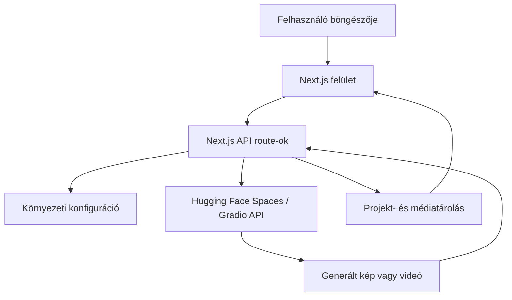
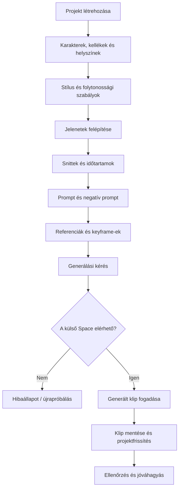

# AI Video Studio

<p align="center">
  <strong>Ötletből látvány.</strong><br/>
  Ingyenes szolgáltatásokra tervezett, böngészőből használható AI kreatív műhely képek és videóprojektek előkészítéséhez.
</p>

<p align="center">
  <a href="https://ai-video-studio-sooty-chi.vercel.app">Élő alkalmazás</a>
  ·
  <a href="https://github.com/HappyFuneral/ai-video-studio">GitHub repository</a>
</p>

---

## Tartalomjegyzék

- [A projektről](#a-projektről)
- [Élő demó](#élő-demó)
- [Fő funkciók](#fő-funkciók)
- [Rendszerfelépítés](#rendszerfelépítés)
- [Technológiai stack](#technológiai-stack)
- [Telepítés és futtatás](#telepítés-és-futtatás)
- [Környezeti változók](#környezeti-változók)
- [Képgenerálás](#képgenerálás)
- [Videóprodukciós munkafolyamat](#videóprodukciós-munkafolyamat)
- [Projektadatok és folytonosság](#projektadatok-és-folytonosság)
- [API-végpontok](#api-végpontok)
- [Tárolás és telepítési megfontolások](#tárolás-és-telepítési-megfontolások)
- [Korlátozások és ismert sajátosságok](#korlátozások-és-ismert-sajátosságok)
- [Hibaelhárítás](#hibaelhárítás)
- [Fejlesztési ötletek](#fejlesztési-ötletek)
- [Közreműködés](#közreműködés)
- [Licenc](#licenc)

---

## A projektről

Az **AI Video Studio** egy Next.js és TypeScript alapú webalkalmazás, amely az AI-alapú vizuális tartalomkészítés folyamatát fogja össze.

A cél nem csupán egy promptmező biztosítása, hanem egy olyan kreatív munkakörnyezet kialakítása, ahol a felhasználó:

1. képi ötleteket dolgozhat ki és generálhat;
2. szöveges promptokkal és negatív promptokkal irányíthatja a generálást;
3. videóötleteket bonthat jelenetekre és snittekre;
4. karaktereket, kellékeket, helyszíneket és vizuális stílust írhat le;
5. a snittekhez külön generálási promptokat és referenciaanyagokat rendelhet;
6. külső, nyilvánosan elérhető Hugging Face Spaces szolgáltatással próbálhat videót generálni.

A projekt **ingyenesen elérhető külső szolgáltatásokra épít**. Nem feltételez helyi GPU-t, és a tervezett ingyenes használati útvonal nem igényel fizetős generálási API-t. A külső szolgáltatások kapacitása, sebessége és elérhetősége azonban nem garantált.

## Élő demó

- **Webalkalmazás:** https://ai-video-studio-sooty-chi.vercel.app
- **Forráskód:** https://github.com/HappyFuneral/ai-video-studio

A publikus weboldal az AI Image Generator és AI Video Generator modulokhoz biztosít belépési felületet.

> **Megjegyzés a funkciók állapotáról:** a GitHubon található korábbi rövid leírás és a fejlesztés közben végzett helyi tesztek nem feltétlenül ugyanazt a kódállapotot írják le. A dokumentum ezért különbséget tesz a felületen megjelenő, a kódban előkészített és a ténylegesen tesztelt funkciók között. A Hugging Face Space működése és kvótája külső tényezőktől függ.

## Fő funkciók

### 1. AI Image Generator

A képgenerátor felülete szöveges leírásból történő képkészítéshez készült.

A repository dokumentációja és konfigurációja alapján az alábbi képességeket célozza:

- pozitív prompt megadása;
- negatív prompt megadása;
- képarány kiválasztása: `1:1`, `16:9`, `9:16`, `4:3`;
- legfeljebb négy kép kérése egy generálási körben;
- Hugging Face Gradio-alapú képgeneráló Space konfigurálása.

A ténylegesen használható modell és paraméterezés a beállított Space API-jától függ. A Space cseréje előtt ellenőrizni kell annak aktuális Gradio API-leírását.

### 2. AI Video Generator

A videógenerátor felülete két általános munkamódra készült:

- **Text-to-Video:** videó létrehozása szöveges promptból.
- **Image-to-Video:** videó létrehozása egy kiinduló kép alapján.

A projektben a videóprodukciós munkafolyamat a hosszabb videókat több rövid snittre bontja. A teljes projekt hossza tehát nem egyetlen generálási kérésként értendő: a hosszabb anyag több különálló klipből állhat.

A Hugging Face Gradio klienssel történő videógenerálás során a Space által visszaadott fájlobjektum videó URL-jét kell feldolgozni. A külső Space által visszaadott fájlhivatkozás ideiglenes lehet, ezért a klipet szükség esetén le kell tölteni és a projekt saját tárhelyére kell menteni.

### 3. Produkciótervezés

A produkciós adatmodell strukturáltan írja le a videóprojektet:

- projektbeállítások;
- karakterbible;
- kellékbible;
- világ- és helyszínleírások;
- vizuális stílusbible;
- jelenetek;
- snittek;
- referenciaanyagok;
- keyframe-ek;
- generált klipek és azok státusza.

Ez a struktúra segít abban, hogy a videó ne egymástól független promptok sorozata legyen, hanem egységes vizuális szabályok alapján felépített produkció.

### 4. Prompt- és folytonosságkezelés

A snittek külön mezőkben tárolhatják:

- a kamerabeállítást;
- a kameramozgást;
- az akció leírását;
- a generálási promptot;
- a negatív promptot;
- a kapcsolódó referenciaanyagokat;
- a keyframe-eket;
- a generálási és jóváhagyási állapotot.

A karakterek, kellékek, helyszínek és stílus folytonossági szabályai segítenek csökkenteni a snittek közötti vizuális eltéréseket. Ezek a szabályok promptadatok: önmagukban nem garantálják, hogy egy külső generatív modell minden képkockán tökéletesen megtartja a megjelenést.

---

## Rendszerfelépítés

### Magas szintű architektúra



A böngésző a Next.js alkalmazással kommunikál. A külső AI-szolgáltatások meghívása szerveroldali API-route-on keresztül történik, így a Hugging Face tokennek nem kell a kliensoldali kódba kerülnie.

### Videóprodukciós folyamat



### Generálási kérés adatútja

1. A felhasználó kiválasztja a projektet és a snittet.
2. A Next.js API-route ellenőrzi a bemeneti adatokat és a konfigurációt.
3. A szerver Gradio kliensen keresztül meghívja a beállított Hugging Face Space-t.
4. A Space elvégzi a generálást a rendelkezésre álló külső erőforráson.
5. A szerver feldolgozza a visszakapott fájlobjektumot.
6. A generált média a projekt számára elérhető helyre kerül, és a projektadatok frissülnek.

---

## Technológiai stack

| Technológia | Szerep |
|---|---|
| Next.js 14.2 | Webalkalmazás és szerveroldali API-route-ok |
| React 18 | Felhasználói felület |
| TypeScript 5.7 | Típusbiztos alkalmazáskód |
| `@gradio/client` 2.7 | Hugging Face Gradio Spaces meghívása |
| `lucide-react` | Ikonkészlet |
| Vercel | Publikus webes telepítés |
| Hugging Face Spaces | Külső AI-generálási környezet |

A verziók a repository `package.json` fájljában rögzített függőségeken alapulnak. A pontos telepített verziókat a `package-lock.json` határozza meg.

## Telepítés és futtatás

### Követelmények

- Node.js **20.9 vagy újabb**;
- npm;
- Git;
- Hugging Face-fiók és opcionálisan read token;
- internetkapcsolat a külső Space eléréséhez.

A videógeneráláshoz nem szükséges helyi NVIDIA GPU, mert a számítás a külső Space környezetében történik.

### 1. Repository klónozása

```bash
git clone https://github.com/HappyFuneral/ai-video-studio.git
cd ai-video-studio
```

### 2. Függőségek telepítése

```bash
npm install
```

### 3. Környezeti fájl létrehozása

Windows PowerShell:

```powershell
Copy-Item .env.local.example .env.local
```

Windows parancssor:

```cmd
copy .env.local.example .env.local
```

### 4. Környezeti változók beállítása

Nyisd meg a `.env.local` fájlt, és állítsd be a használni kívánt Hugging Face Space adatait. A változók részletes leírása a következő fejezetben található.

### 5. Fejlesztői szerver indítása

```bash
npm run dev
```

Ezután nyisd meg:

```text
http://localhost:3000
```

### 6. Production build

A TypeScript- és Next.js build ellenőrzéséhez:

```bash
npm run build
```

A production build helyi indítása:

```bash
npm run start
```

---

## Környezeti változók

A repository `.env.local.example` fájlja az alábbi beállításokat tartalmazza:

| Változó | Leírás |
|---|---|
| `HF_TOKEN` | Opcionális Hugging Face read token. Szerveroldali környezeti változóként használandó. |
| `HF_SPACE` | A videógeneráláshoz használt Hugging Face Space azonosítója. |
| `HF_API_NAME` | A Space Gradio API-függvényének neve. |
| `HF_IMAGE_SPACE` | A képgeneráló Space azonosítója. |
| `HF_IMAGE_API_NAME` | A képgeneráló Space API-függvényének neve. |
| `LTX_API_KEY` | Opcionális LTX szolgáltatáskulcs, ha az adott integrációt használod. |
| `LTX_TEXT_TO_VIDEO_ENDPOINT` | Opcionális LTX Text-to-Video végpont. |
| `LTX_IMAGE_TO_VIDEO_ENDPOINT` | Opcionális LTX Image-to-Video végpont. |
| `MAX_VIDEO_DURATION` | A projektben megengedett maximális videóhossz konfigurációja. |
| `IMAGE_BATCH_SIZE` | Képgenerálási köteg mérete. |
| `IMAGE_TARGET_SECONDS` | Képgeneráláshoz kapcsolódó célérték másodpercben. |

Példa a fájl szerkezetére:

```dotenv
HF_TOKEN=
HF_SPACE=umer-un/prompt-to-video
HF_API_NAME=/text_to_video

HF_IMAGE_SPACE=
HF_IMAGE_API_NAME=

LTX_API_KEY=
LTX_TEXT_TO_VIDEO_ENDPOINT=
LTX_IMAGE_TO_VIDEO_ENDPOINT=

MAX_VIDEO_DURATION=180
IMAGE_BATCH_SIZE=4
IMAGE_TARGET_SECONDS=30
```

> A példaértékek a repositoryban található `.env.local.example` fájlból származnak. A Space neve, API-függvénye és paraméterei változhatnak. Mindig ellenőrizd az adott Space aktuális Gradio API-leírását.

### Biztonság

- A `.env.local` fájlt **ne töltsd fel GitHubra**.
- A Hugging Face tokent ne illeszd be kliensoldali komponensbe.
- A token neve ne `NEXT_PUBLIC_` előtaggal kezdődjön.
- Publikus repositoryban kizárólag üres vagy egyértelműen példaértékű változókat szerepeltess.
- Ha token véletlenül nyilvánosságra kerül, vond vissza a Hugging Face beállításainál, és hozz létre újat.

---

## Képgenerálás

A képgenerálás Hugging Face Spaces Gradio API-n keresztül konfigurálható.

Általános munkafolyamat:

1. A felhasználó megadja a kép leírását.
2. Szükség esetén negatív promptot ad meg.
3. Kiválasztja a képarányt.
4. Megadja a kért képek számát a támogatott tartományon belül.
5. A szerveroldali route meghívja a konfigurált Space-t.
6. A felület megjeleníti a visszakapott eredményt.

A Gradio Space-ok eltérő bemeneti paramétereket és visszatérési struktúrákat használhatnak. Space-váltáskor ezért a klienskódot is hozzá kell igazítani az új API-hoz.

## Videóprodukciós munkafolyamat

A videóprojekt célja, hogy a teljes videót kezelhető produkciós egységekre bontsa.

### Projekt

A projekt tárolja többek között:

- cím és leírás;
- teljes tervezett időtartam;
- képkockasebesség;
- képarány;
- master felbontás;
- zenei BPM;
- karakterek, kellékek, világ és stílus;
- jelenetek.

### Karakterbible

Egy karakterbejegyzés a következő adatokat tartalmazza:

- név és szerep;
- külső megjelenés;
- ruházat;
- személyiség;
- folytonossági szabályok;
- referenciaanyagok.

### Kellékbible

A kellékeknél rögzíthető:

- név;
- leírás;
- vizuális részletek;
- folytonossági szabályok;
- referenciaanyagok.

### Világ és helyszínek

A világ leírása mellett minden helyszín külön adatként kezelhető:

- helyszín neve és leírása;
- napszak;
- atmoszféra;
- vizuális részletek;
- referenciák.

### Stílusbible

A stílusbeállítás a projekt egységes képi világát írja le:

- médium;
- renderelési stílus;
- színpaletta;
- világítás;
- kameranyelv;
- textúra;
- folytonossági szabályok;
- referenciaanyagok.

### Jelenetek és snittek

Egy jelenet időintervallumot, összefoglalót, helyszínt és kapcsolódó karaktereket/kellékeket tartalmazhat.

A snitt külön kezeli:

- sorszám és cím;
- tervezett időtartam;
- kamera és kameramozgás;
- akció;
- pozitív és negatív prompt;
- referenciaazonosítók és referenciaobjektumok;
- keyframe-ek;
- generálási státusz;
- generált klipek.

### Snittállapotok

A jelenlegi TypeScript-adatmodell a következő snittállapotokat definiálja:

| Állapot | Jelentés |
|---|---|
| `draft` | Előkészítés alatt |
| `ready` | Generálásra előkészítve |
| `generating` | Generálás folyamatban |
| `generated` | Elkészült legalább egy generált klip |
| `approved` | Jóváhagyott snitt |
| `failed` | Sikertelen generálás |

### Keyframe-ek

A keyframe egy adott időponthoz rendelt referencia-képkocka:

- azonosító;
- időpont másodpercben;
- kép elérési útja;
- leírás.

A keyframe-ek segíthetnek a snitt vizuális szándékának pontosításában. A tényleges Image-to-Video használat a konfigurált Space képességeitől és a hozzá tartozó API-tól függ.

### Generált klipek

Egy generált klip adatmodellje rögzíti:

- szolgáltató;
- modell;
- mentett videó elérési útja;
- videó URL-je;
- időtartam;
- létrehozás ideje;
- státusz;
- megjegyzések.

A klip státusza lehet `generated`, `approved` vagy `rejected`.

---

## Projektadatok és folytonosság

A produkciós projekt TypeScript-modellje a következő fő típusokra épül:

```text
ProductionProject
├── characters: CharacterBibleEntry[]
├── props: PropBibleEntry[]
├── world: WorldBible
│   └── locations: LocationBibleEntry[]
├── style: StyleBible
└── scenes: Scene[]
    └── shots: Shot[]
        ├── references: ReferenceAsset[]
        ├── keyframes: Keyframe[]
        └── generatedClips: GeneratedClip[]
```

A típusdefiníciók helye a projektben:

```text
src/lib/production/types.ts
```

A projektadatok mentését és visszaolvasását a produkciós store kezeli. A pontos fájlrendszeres vagy platformfüggő tárolási viselkedés a futtatási környezettől függ.

## API-végpontok

A repository README-jében dokumentált végpontok:

| Metódus | Útvonal | Szerep |
|---|---|---|
| `POST` | `/api/generate-image` | Képgenerálási kérés |
| `GET` | `/api/health` | Alapvető állapotellenőrzés |

A produkciós fejlesztési munkafolyamatban használt route-ok:

| Metódus | Útvonal | Szerep |
|---|---|---|
| `POST` | `/api/production/generate` | Snitt videógenerálásának indítása |
| `GET` / `POST` | `/api/production` | Produkciós projektek kezelése |
| `GET` / `PUT` / `DELETE` | `/api/projects/[projectId]` | Egy projekt lekérése, módosítása és törlése |

> Az API-k pontos HTTP-metódusait és kérés-/válaszsémáit a forráskódban kell ellenőrizni az aktuális commit alapján. Ez a táblázat a projektben ismert útvonalakat foglalja össze; nem helyettesíti az endpointok implementációját.

## Tárolás és telepítési megfontolások

A helyi fejlesztői környezet és a szerver nélküli hosting nem azonos tárolási környezet.

- Helyi futtatásnál a projekt fájlrendszerére mentett média a gépen elérhető.
- Vercel serverless környezetben a futtatási fájlrendszer nem tekinthető tartós, megosztott médiatárnak.
- A `public/` könyvtár build során publikált statikus fájlokat tartalmaz; futás közben oda írt fájlok tartós tárolása nem garantált.
- Éles, több felhasználós vagy hosszú távú használathoz objektumtár vagy más tartós adattároló szükséges.

Ha a projekt generált videókat vagy képeket helyi mappába ment, Vercelre telepítés előtt ellenőrizni kell, hogy a média valóban megmarad-e a következő kérésnél vagy új deploy után. A sikeres helyi teszt önmagában nem igazolja a tartós felhős tárolást.

## Korlátozások és ismert sajátosságok

### Külső GPU-kapacitás

A Hugging Face Spaces nyilvános, ingyenes erőforrásai korlátozottak lehetnek. Előfordulhat:

- hosszú várakozás;
- sorban állás;
- worker-hiba;
- átmeneti elérhetetlenség;
- modell- vagy API-változás;
- időtartam- vagy felbontáskorlát.

### A projekt időtartama és a klip időtartama nem ugyanaz

Egy 180 vagy 185 másodperces projektterv nem jelenti azt, hogy a generáló Space egyetlen kérésre ilyen hosszú videót készít. A hosszú videó több rövid klipből állhat össze.

A generálási route-ban alkalmazott maximális kliphossz és a projektben megadott tervezett snitthossz eltérhet. Generálás előtt ellenőrizni kell, hogy a mentett klip tényleges időtartama megfelel-e a tervezettnek.

### Ingyenesség

A projekt ingyenes szolgáltatásokra épülő használatra készült, de a külső szolgáltatók kvótái és feltételei változhatnak. Fizetős API vagy előfizetés használata csak külön, tudatos konfigurációval történjen.

### Generálási eredmény

A generatív modellek nem garantálják a karakterek, tárgyak, mozgások és jelenetek tökéletes folytonosságát. A promptok és referenciák javíthatják az eredményt, de a kész klipeket ellenőrizni kell.

---

## Hibaelhárítás

### `HF_TOKEN` vagy hitelesítési hiba

- Ellenőrizd, hogy a token érvényes-e.
- A token legyen Hugging Face read token.
- Ellenőrizd, hogy a `.env.local` fájl a projekt gyökerében található-e.
- Környezeti változó módosítása után indítsd újra a fejlesztői szervert.
- A tokent ne másold be hibajegybe vagy nyilvános chatbe.

### Gradio endpoint vagy API-hiba

- Nyisd meg a kiválasztott Space oldalát.
- Ellenőrizd, hogy a Space fut-e.
- Ellenőrizd a Gradio API-dokumentációban az endpoint nevét.
- Ellenőrizd a paraméterek számát, sorrendjét és típusát.
- Ellenőrizd a `HF_SPACE` és `HF_API_NAME` értékeket.

### ZeroGPU worker error

Ez jellemzően a külső generálási környezethez kapcsolódik, nem feltétlenül a Next.js alkalmazás hibája.

Próbáld meg:
1. rövidebb kliphosszal;
2. kisebb felbontással;
3. egyszerre csak egy generálással;
4. később újrapróbálva, ha a Space túlterhelt.

A rövidebb klip sem garantálja a sikert, de segíthet elkülöníteni a kapacitásproblémát a hibás API-hívástól.

### A build hibával leáll

```bash
npm install
npm run build
```

Ellenőrizd a terminálban az első TypeScript- vagy modulhibát. Érdemes az első hibát javítani, majd újra futtatni a buildet.

### A generált média nem érhető el Vercelen

Ellenőrizd, hogy a fájl tartós tárhelyre kerül-e. A Vercel futtatási fájlrendszerére mentett generált fájl nem feltétlenül marad meg. Éles környezetben használj tartós objektumtárat.

---

## Fejlesztési ötletek

Lehetséges következő fejlesztési irányok:

- tartós felhős médiatárolás;
- generálási sor és várakozási állapot;
- automatikus újrapróbálás átmeneti Space-hibáknál;
- a tényleges és tervezett kliphossz külön kezelése;
- több Space és modell közötti konfigurálható választás;
- Image-to-Video referenciafolyamat teljes körű ellenőrzése;
- snittek előnézete és jóváhagyási munkafolyamata;
- videók összeillesztése és exportálása;
- részletes API-dokumentáció és automatizált tesztek;
- felhasználói útmutató képernyőképekkel.

## Közreműködés

A fejlesztéshez:

1. Forkold a repositoryt.
2. Hozz létre egy külön branchet.
3. Készítsd el a módosításokat.
4. Futtasd a buildet:

   ```bash
   npm run build
   ```

5. Nyiss Pull Requestet, és írd le a változtatásokat, valamint a tesztelés eredményét.

Ne tölts fel tokent, `.env.local` fájlt vagy más titkos konfigurációt.

## Licenc

A repository jelenlegi nyilvános leírása nem nevez meg licencet. Amíg a projekt gyökerében nincs `LICENSE` fájl, a felhasználási, módosítási és terjesztési jogokat ne tekintsd automatikusan engedélyezettnek. A nyílt forráskódú licencet a repository tulajdonosának kell kiválasztania és hozzáadnia.

---

<p align="center">
  <strong>AI Video Studio</strong><br/>
  Kreatív tervezés, képgenerálás és AI-videóprodukció egy helyen.
</p>
